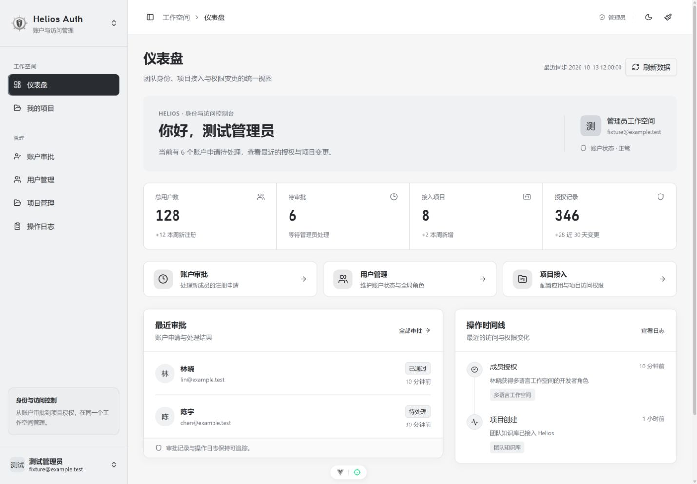
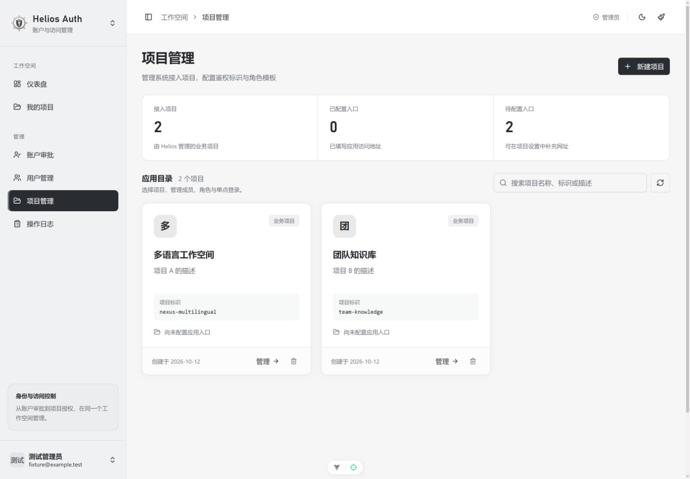
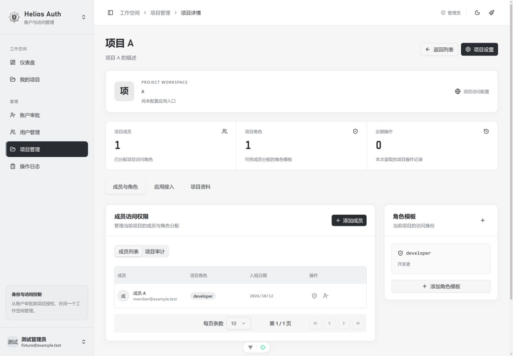
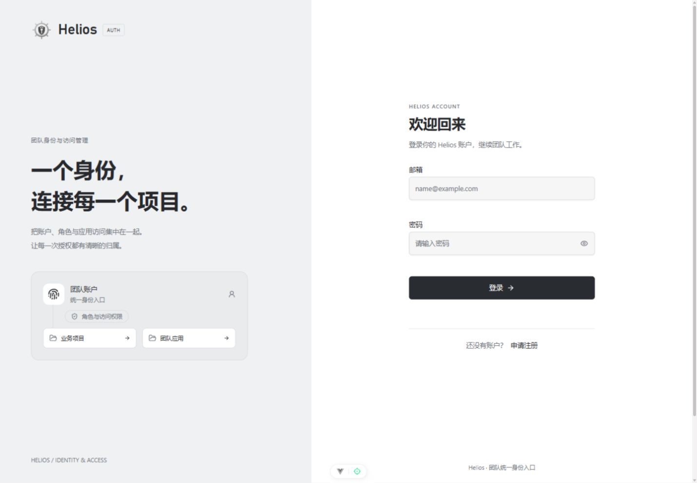

# Helios 管理界面重构

用户明确要求整套 UI 重构，并选择「黑白灰：低饱和、简洁克制」。本轮保留原有 API、权限判断与请求上下文保护，重新组织页面布局和视觉系统。未提交、未部署。

## 最终页面

- 264px 浅灰导航、72px 页头，黑色选中项与共享标题层级。
- 仪表盘：身份概览、连续统计带、工作入口、审批列表、操作时间线。
- 用户 / 审批：真实账户统计、统一搜索筛选面板、可读表格；失败读取显示恢复入口。
- 项目 / 我的项目：应用卡片目录、完整项目标识与明确操作。
- 项目详情：成员与角色、应用接入、项目资料三个可键盘操作的标签；接入面板保持挂载，切换标签保留输入和请求。
- 登录 / 注册：共享 AuthShell 双栏布局，移动端紧凑表单；内联校验、自动填充与密码显隐。
- 个人资料：账户身份卡与信息定义列表。
- 操作日志：查询统计、明确筛选、分页与导出；加载不冒充空数据。

## 设计对齐

| 旧设计 / 差异                       | 最终决策                                                         |
| ----------------------------------- | ---------------------------------------------------------------- |
| 黑白模板只做间距修整                | 用户要求全面重构，保留灰阶偏好但重新组织信息与布局               |
| 深蓝 / 青绿方案                     | 用户明确否决；统一黑白灰语义 token，错误/删除保留红色            |
| 旧主题与基础 CSS 同级导致覆盖不稳定 | 主题使用 :root.theme-\* 适配，品牌 token 只有 style.css 一个来源 |
| 项目详情巨型装饰与极小文本          | 换成业务区域、原生语义列表、可访问 Tabs 和清晰字号               |
| 未实现的账户设置入口与虚构 OA 文案  | 移除无效入口，保留实际支持的账户资料与头像操作                   |

## 验证

- 完整检查：lint、vue-tsc、9 项回归测试、7 项 API 契约检查。
- 生产构建：通过。
- strict UI 静态审计：0 findings；DESIGN.md lint：0 errors，3 个既有文档 token 引用警告。
- 浏览器：桌面首页/应用目录/项目详情/认证页，375px 注册与用户页无全局横向溢出；黑白灰深色模式。
- 项目详情：切换标签保留应用配置草稿；取消修改设置保留放弃确认。
- 共享搜索：清除恢复焦点；窄屏分页选择器触发器与弹层均为 70px。
- 注册：必填错误关联字段，并聚焦首个无效字段。
- 预览只包含内存测试数据；认证请求日志省略凭据。

真实生产后端操作、跨应用 SSO 联调、屏幕阅读器及全平台矩阵未执行。

## 预览

